# BonfireRest Videogames

Sitio web de una tienda online de videojuegos, desarrollado como **Evaluación Final Transversal** de la asignatura **Desarrollo Frontend I (PFY2201)** de Duoc UC.

La tienda muestra el catálogo de videojuegos de PS5 en tarjetas, permite filtrarlos por categoría, tiene **carrito de compras** e incluye un formulario de contacto con validación. El proyecto se entrega en dos versiones que corresponden a las etapas del encargo:

| Carpeta | Tecnologías | Qué demuestra |
|---|---|---|
| [`vanilla/`](vanilla/) | HTML5, CSS3, JavaScript, Bootstrap 5 | Estructura semántica, Flexbox / CSS Grid, manipulación del DOM, filtrado y validación con JavaScript puro |
| [`react/`](react/) | React 19, Vite, Bootstrap 5 | Componentes reutilizables, estado (`useState`, `useEffect`), props entre componentes, agregar y eliminar videojuegos |

**Autor:** Felix Barahona, Duoc UC, 2026

---

## Funcionalidades

### Versión HTML + JavaScript (`vanilla/`)

- Barra de navegación responsiva de Bootstrap con menú hamburguesa en móvil.
- Catálogo generado **dinámicamente**: `js/data.js` define un arreglo de objetos con nombre, categoría, precio, descripción e imagen, y `js/app.js` lo recorre y crea cada tarjeta con `createElement`. El HTML no contiene ninguna tarjeta escrita a mano.
- **Filtro por categoría**: los botones se generan a partir de las categorías del arreglo (`Set`), e incluyen la opción "Todas" y un contador de resultados.
- **Formulario de contacto validado** (nombre, email, mensaje):
  - campos obligatorios
  - nombre de 3 o más letras
  - email con formato válido
  - mensaje de 10 o más caracteres
  
  Muestra el error bajo cada campo y bloquea el envío si algo está mal. Si todo está correcto, muestra un mensaje de éxito y limpia el formulario.
- **Carrito de compras** (`js/carrito.js`), en un panel lateral (*offcanvas* de Bootstrap):
  - agregar juegos, sumar o restar unidades (máximo 10 por juego) y quitar productos
  - subtotal por producto, total y contador en la navbar
  - vaciar el carrito y finalizar la compra (simulada)
  - el carrito se guarda en `localStorage`, así que no se pierde al recargar la página

### Versión React (`react/`)

- Todo lo anterior, construido con componentes.
- Catálogo cargado desde `public/data/videojuegos.json` con `fetch` dentro de `useEffect`, con estados de *cargando* y *error* (con botón "Reintentar").
- **Agregar videojuegos** desde un formulario validado y **eliminar** cualquier videojuego desde su tarjeta.
- Botón **"Restaurar catálogo original"**, que vuelve a cargar el JSON.
- El contador de la navbar se actualiza al agregar o eliminar juegos, como ejemplo de props conectando componentes.
- **Carrito de compras** con la misma funcionalidad que la versión HTML. La lógica está en el hook personalizado `useCarrito()`, y los componentes `Cart` y `CartItem` la muestran. Si se elimina del catálogo un juego que estaba en el carrito, también se quita del carrito.

---

## Estructura del proyecto

```
├── README.md
├── .gitignore
├── evidencias/              Capturas de pruebas responsivas
├── vanilla/
│   ├── index.html           Estructura semántica (header, nav, main, section, aside, footer)
│   ├── css/styles.css       Estilos propios: variables, Flexbox, CSS Grid, media queries
│   ├── js/data.js           Arreglo de objetos con los videojuegos
│   ├── js/app.js            Render dinámico, filtro y validación del formulario
│   ├── js/carrito.js        Carrito de compras (localStorage + delegación de eventos)
│   └── img/                 Portadas de los juegos (.jpg), portada genérica y favicon
└── react/
    ├── index.html
    ├── package.json
    ├── vite.config.js
    ├── public/
    │   ├── data/videojuegos.json   Fuente de datos que se carga con fetch
    │   └── img/                    Portadas de los juegos (.jpg) y portada genérica
    └── src/
        ├── main.jsx                Punto de entrada: importa Bootstrap y monta <App />
        ├── App.jsx                 Componente raíz: estado principal y lógica
        ├── styles.css
        ├── hooks/
        │   └── useCarrito.js       Hook personalizado: estado y lógica del carrito
        ├── utils/
        │   ├── formato.js          formatearPrecio()
        │   └── validaciones.js     Reglas de validación reutilizables
        └── components/
            ├── Navbar.jsx
            ├── Hero.jsx
            ├── CategoryFilter.jsx
            ├── GameList.jsx
            ├── GameCard.jsx
            ├── AddGameForm.jsx
            ├── ContactForm.jsx
            ├── FormField.jsx       Campo de formulario reutilizable
            ├── Cart.jsx            Panel lateral del carrito (offcanvas)
            ├── CartItem.jsx        Fila de un producto del carrito
            └── Footer.jsx
```

### Árbol de componentes y flujo de datos (React)

```
App  (estado: juegos, categoria, cargando, errorCarga + useCarrito())
├── Navbar           ← totalJuegos, unidadesCarrito
├── Hero
├── CategoryFilter   ← categorias, seleccionada, totalVisibles, onCambiarCategoria()
├── GameList         ← juegos (ya filtrados), carrito, onEliminar(), onAgregarAlCarrito()
│   └── GameCard     ← juego, cantidadEnCarrito, onEliminar(), onAgregarAlCarrito()
├── AddGameForm      ← categorias, onAgregar()      (estado propio del formulario)
│   └── FormField
├── ContactForm                                      (estado propio del formulario)
│   └── FormField
├── Footer
└── Cart             ← items, total, unidades, onCambiarCantidad(), onQuitar(), onVaciar()
    └── CartItem     ← item, onCambiarCantidad(), onQuitar()
```

Los datos **bajan** como props y los eventos **suben** mediante funciones callback. Ejemplo: al hacer clic en una categoría, `CategoryFilter` llama a `onCambiarCategoria("RPG")`, `App` actualiza su estado `categoria`, recalcula la lista filtrada y `GameList` vuelve a renderizarse con los juegos de esa categoría.

---

## Requisitos

- Un navegador moderno: Chrome, Edge o Firefox.
- Para la versión React: **Node.js 20.19 o superior** (recomendado: 22 LTS) y npm. Se puede verificar con `node -v`.
- Conexión a internet para cargar Bootstrap (CDN) y las tipografías de Google Fonts en la versión `vanilla/`.

---

## Instalación y uso

### 1. Clonar el repositorio

```bash
git clone https://github.com/Felo0o0/bonfirerest-videogames.git
cd bonfirerest-videogames
```

### 2. Versión HTML + JavaScript

No necesita instalación. Hay dos formas de abrirla:

- Abrir `vanilla/index.html` con doble clic en el navegador, o
- Abrir la carpeta en VS Code y usar la extensión **Live Server** (clic derecho en `index.html` → *Open with Live Server*).

### 3. Versión React

```bash
cd react
npm install        # instala React, Vite y Bootstrap (solo la primera vez)
npm run dev        # inicia el servidor de desarrollo
```

Abrir en el navegador la dirección que aparece en la terminal (por defecto `http://localhost:5173`).

Otros comandos:

| Comando | Descripción |
|---|---|
| `npm run build` | Genera la versión de producción en `react/dist/` |
| `npm run preview` | Sirve localmente la versión de producción ya generada |
| `npm run lint` | Revisa el código con oxlint |

> La versión React **no** funciona abriendo `react/index.html` con doble clic: necesita `npm run dev` (o `npm run preview` después de `npm run build`), porque Vite debe transformar JSX y `fetch` necesita un servidor.

---

## Cómo usar el sitio

1. **Navegar:** usa los enlaces de la barra superior (Inicio, Catálogo, Contacto). En móvil, ábrelos con el botón ☰.
2. **Filtrar:** en la sección Catálogo, pulsa una categoría (Soulslike, Acción, RPG, Indie) o "Todas". El contador indica cuántos juegos se están mostrando.
3. **Contacto:** completa nombre, email y mensaje y pulsa *Enviar mensaje*. Si falta un dato o tiene un formato incorrecto, el campo se marca en rojo con el motivo del error.
4. **Comprar:** pulsa *Agregar* (o *Agregar al carrito*) en un juego. Abre el carrito con el botón **Carrito** de la barra superior; ahí puedes cambiar cantidades con − y +, quitar productos con ✕, vaciar el carrito o *Finalizar compra*. La compra es simulada: no hay pago real.
5. **Agregar un videojuego** (solo React): en *Agregar videojuego*, completa nombre, categoría, precio y descripción. La URL de la imagen es opcional; si se deja vacía se usa una portada genérica. El juego aparece al final del catálogo.
6. **Eliminar un videojuego** (solo React): pulsa *Eliminar* en su tarjeta.
7. **Restaurar** (solo React): *Restaurar catálogo original* vuelve a cargar los 10 juegos del JSON.

---

## Catálogo y precios

El catálogo tiene 10 juegos de **PlayStation 5** en formato físico, en 4 categorías: RPG, Acción, Plataformas y Shooter. Para fijar los precios se compararon dos tiendas chilenas especializadas, **Weplay** y **Sniper.cl**, el 11 de octubre de 2026. El sitio usa el **precio menor** de cada juego.

| Juego | Weplay | Sniper.cl | Precio usado |
|---|---:|---:|---:|
| Elden Ring Nightreign | $34.990 | $34.990 | $34.990 |
| Metaphor: ReFantazio | $79.990 | $74.990 | $74.990 |
| Final Fantasy XVI | $49.990 | $49.990 | $49.990 |
| Final Fantasy Tactics: The Ivalice Chronicles | $59.990 | $79.990 | $59.990 |
| Ghost of Yōtei | $39.990 | $59.990 | $39.990 |
| God of War Ragnarök | $42.990 | $63.990 | $42.990 |
| Marvel's Spider-Man 2 | $42.990 | $49.990 | $42.990 |
| Marvel's Spider-Man: Miles Morales | $32.990 | $49.990 | $32.990 |
| Astro Bot | $32.990 | $74.990 | $32.990 |
| Battlefield 6 | $44.990 | $54.990 | $44.990 |
| **Total (10 juegos)** | **$461.900** | **$593.900** | **$456.900** |

Weplay fue más barata o igual en 9 de los 10 juegos. Varios de esos precios son ofertas, y algunos productos de Weplay figuraban como *disponible solo en tienda*. Los precios cambian con el tiempo; estos corresponden a la fecha indicada.

### Imágenes

Las portadas (carátulas de la edición física de PS5) se obtuvieron de las fichas de producto de [Weplay](https://www.weplay.cl). Se recortó el margen blanco y se redujeron a 480 px de ancho para que la página cargue rápido. Están en `vanilla/img/` y `react/public/img/`, y se nombran con el `id` de cada juego (ejemplo: `astro-bot.jpg`). Si una imagen falta o falla, la tarjeta muestra automáticamente `sin-portada.svg`.

---

## Diseño responsivo y pruebas

- Grilla de Bootstrap en el catálogo: 1 columna en móvil, 2 en tablet (`sm`), 3 en escritorio (`lg`) y 4 en pantallas grandes (`xl`).
- **Flexbox:** hero, barra de filtros (con `flex-wrap`), cuerpo de las tarjetas y footer.
- **CSS Grid:** sección de contacto (1 columna en móvil, `1fr 2fr` desde 992 px).
- Pruebas realizadas:

| Prueba | Resultado |
|---|---|
| Anchos de 375 px, 768 px y 1280 px sin desplazamiento horizontal | OK |
| Menú hamburguesa en móvil | OK |
| Filtro por cada categoría y "Todas" | OK |
| Formulario vacío, email inválido y envío correcto | OK |
| Agregar juego (con errores y válido) y eliminar juego | OK |
| Carrito: agregar, sumar/restar, total, persistencia al recargar, finalizar compra | OK |
| Consola del navegador sin errores | OK |
| Navegadores: Firefox (versión HTML) y Edge (versión React) | OK |

Capturas en la carpeta [`evidencias/`](evidencias/). La consola de cada captura está abierta y sin errores.

**Versión HTML + JavaScript (Firefox)**

| Escritorio | Escritorio con carrito |
|---|---|
| 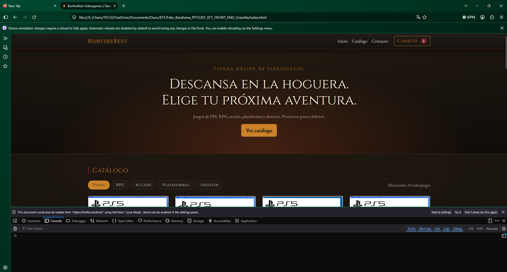 | 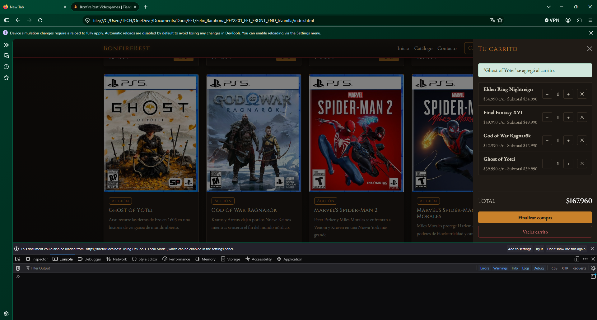 |
| **Móvil 375 px** | **Móvil 375 px con carrito** |
| 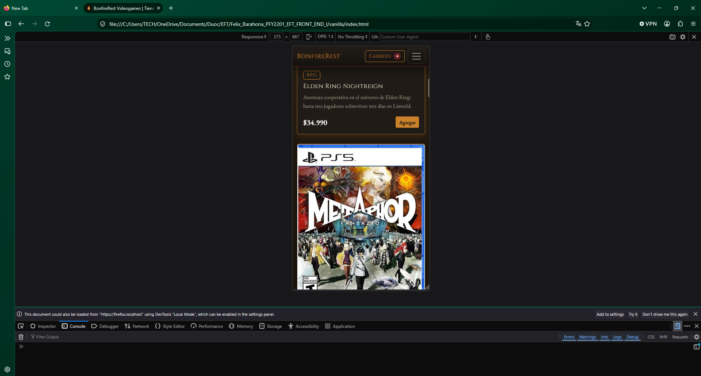 | 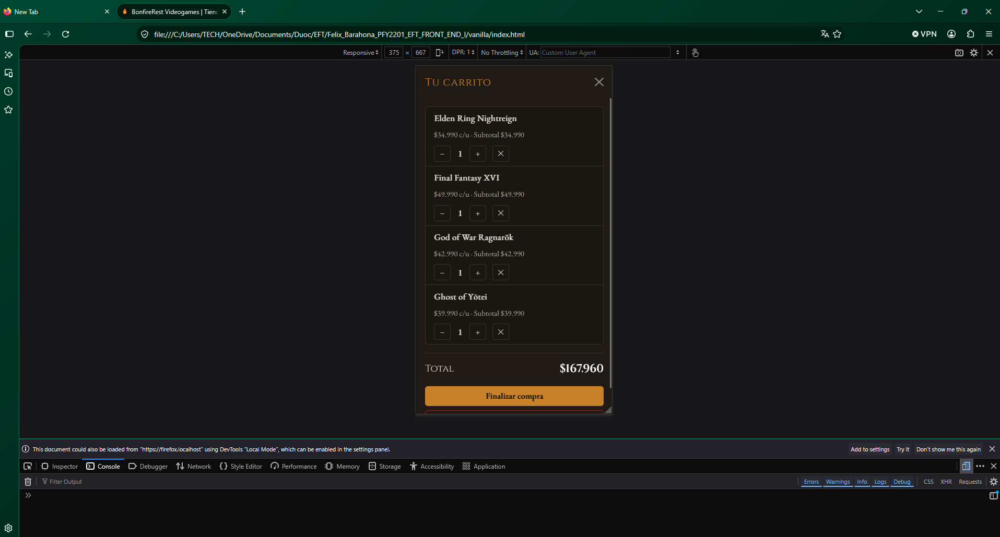 |

**Versión React (Edge)**

| Escritorio | Filtro RPG |
|---|---|
| 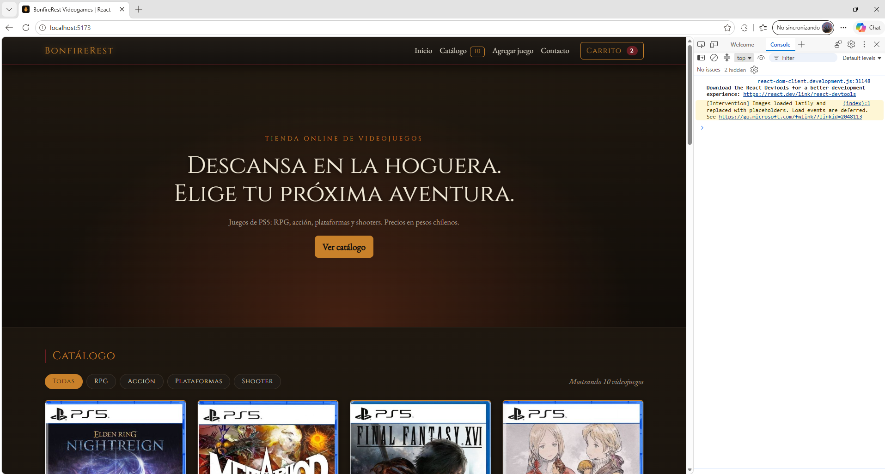 | 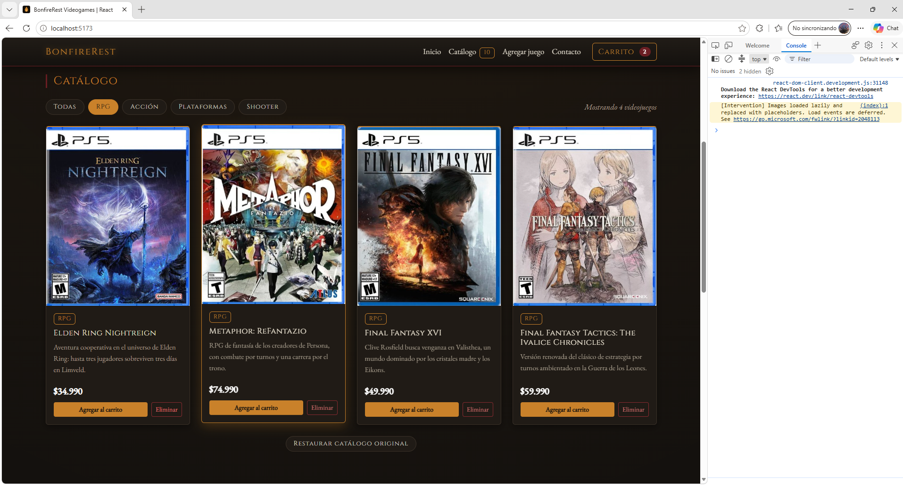 |
| **Carrito** | **Juego agregado al catálogo** |
| 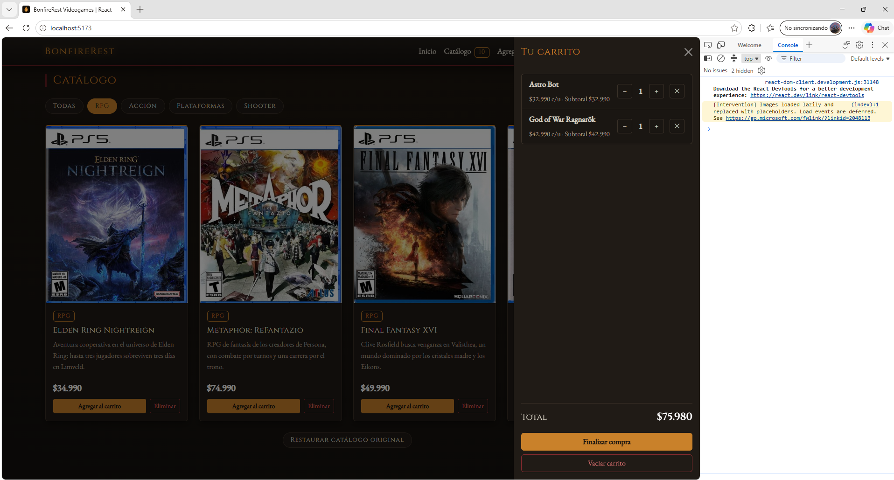 | 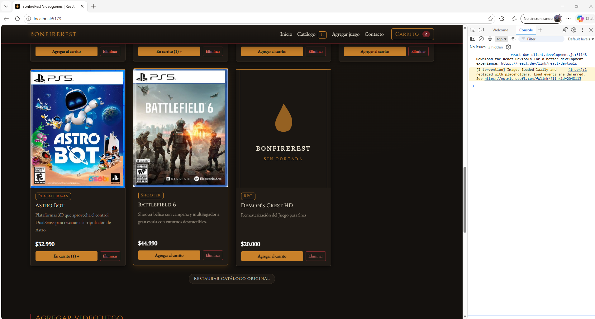 |
| **Formulario de agregar: envío correcto** | **Tablet 768 px, filtro Acción** |
| 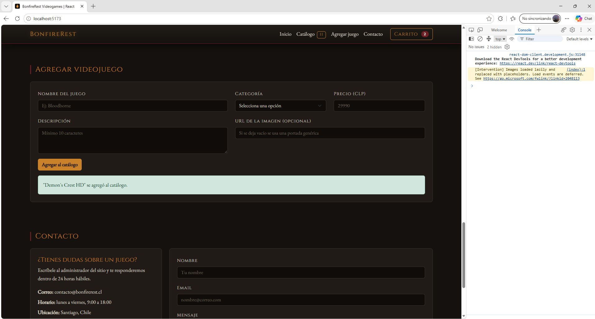 | 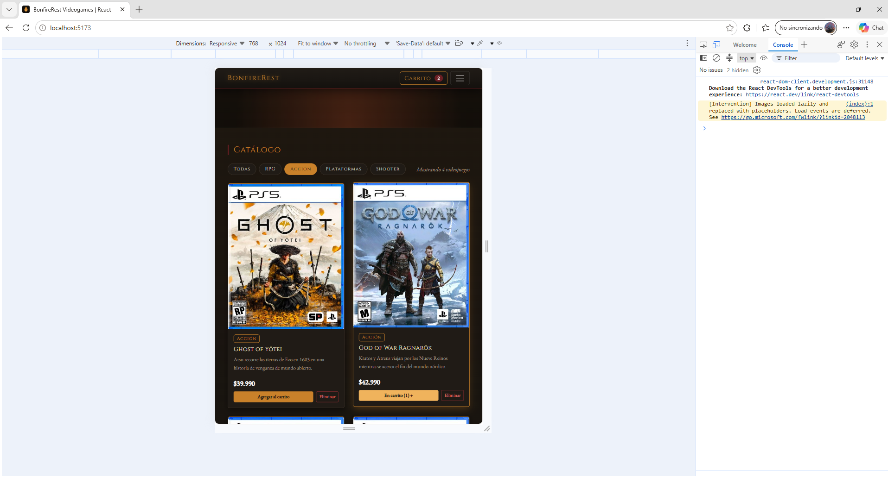 |
| **Tablet 768 px con carrito** | **Móvil 375 px, filtro Shooter** |
| 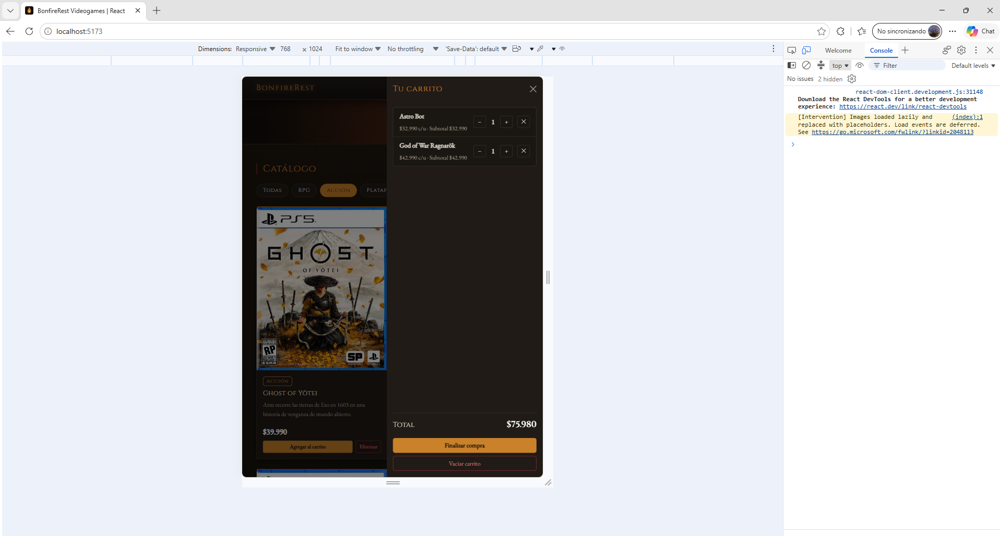 | 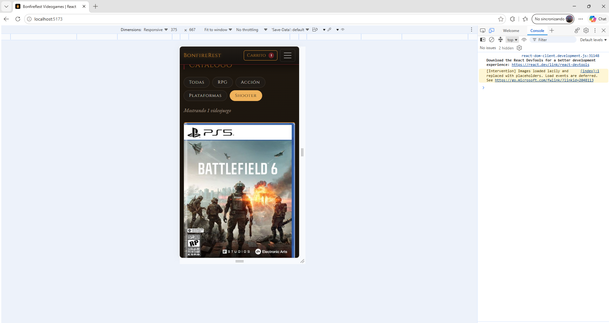 |
| **Móvil 375 px con carrito** | |
| 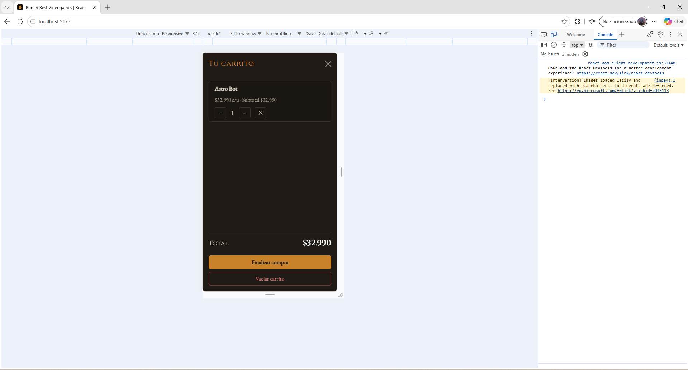 | |

---

## Tecnologías

- HTML5 semántico
- CSS3: custom properties, Flexbox, CSS Grid, media queries
- JavaScript ES6+: `createElement`, eventos y delegación de eventos, `filter`, `map`, `reduce`, `Set`, `fetch`, `async/await`, `localStorage`
- [Bootstrap 5.3](https://getbootstrap.com/): navbar, cards, formularios, alertas, grilla
- [React 19](https://react.dev/) con [Vite](https://vite.dev/): `useState`, `useEffect`, hook personalizado (`useCarrito`)
- Git y GitHub para el control de versiones

## Créditos

Los nombres, portadas y marcas de los videojuegos pertenecen a sus respectivos dueños y se usan solo con fines académicos. Las portadas provienen de [Weplay](https://www.weplay.cl), y los precios de referencia de [Weplay](https://www.weplay.cl) y [Sniper.cl](https://sniper.cl).
